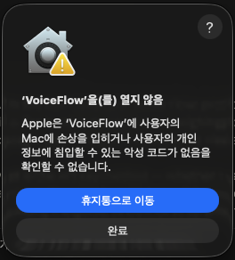
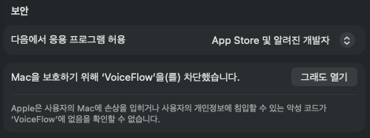
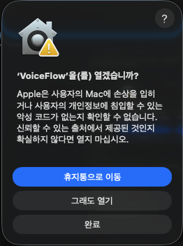

# VoiceFlow 설치 안내

VoiceFlow는 말을 받아써 주고, 회의를 녹음해 정리해 주는 맥 앱입니다. 아래 순서대로 한 번만 따라 하시면 됩니다. 10분 정도 걸립니다.

## 1. 설치 파일 받기

**[맥용 VoiceFlow 받기](https://github.com/skrduq501-sys/voiceflow-releases/releases/latest/download/VoiceFlow-mac.dmg)** (약 200MB)

이 링크는 늘 최신 버전을 받습니다. M1 이후의 애플 실리콘 맥에서만 동작합니다. 내 맥이 맞는지는 화면 왼쪽 위 사과 메뉴 › 이 Mac에 관하여에서 "칩" 항목이 Apple M으로 시작하는지 보면 됩니다.

## 2. 응용 프로그램 폴더로 옮기기

받은 `VoiceFlow-mac.dmg`를 두 번 눌러 엽니다. 창이 뜨면 VoiceFlow 아이콘을 옆의 응용 프로그램 폴더로 끌어다 놓습니다.

## 3. 처음 열 때 나오는 경고는 정상입니다

응용 프로그램 폴더에서 VoiceFlow를 열면 아래 경고가 뜹니다. 아직 시험판이라 Apple의 확인 절차를 거치지 않아서 나오는 안내이고, 앱에 문제가 있다는 뜻이 아닙니다.

**휴지통으로 이동**이 아니라 아래의 **완료**를 누릅니다.

## 4. 시스템 설정에서 열어 주기

1. 사과 메뉴 › **시스템 설정**을 엽니다.
2. 왼쪽 목록에서 **개인정보 보호 및 보안**을 누릅니다.
3. 오른쪽을 맨 아래까지 내리면 "보안" 아래에 VoiceFlow가 차단됐다는 줄이 있습니다. **그래도 열기**를 누릅니다.

4. 한 번 더 묻는 창이 뜹니다. 여기서도 파란 **휴지통으로 이동**이 아니라 가운데 **그래도 열기**를 누릅니다.

5. 맥 로그인 암호(또는 Touch ID)를 넣으면 VoiceFlow가 열립니다. 이 과정은 처음 한 번만 하면 됩니다.

## 5. 권한 허용하기

VoiceFlow가 마이크, 손쉬운 사용, 화면 녹화 권한을 물어봅니다. 모두 허용해 주세요. 마이크는 내 목소리, 화면 녹화는 화상회의 상대방 소리, 손쉬운 사용은 받아쓴 글을 다른 앱에 붙여넣는 데 씁니다. 앱의 설정 › 권한에서 언제든 다시 확인할 수 있습니다.

## 6. 음성 모델 받기 (자동)

처음 켜면 왼쪽에 "음성 모델 받는 중"이 보이고, 음성인식 모델(약 550MB)을 한 번 받습니다. 인터넷 속도에 따라 1~5분 걸립니다. 다 받을 때까지는 받아쓰기를 쓸 수 없고, 그동안 녹음한 회의는 모델을 다 받으면 자동으로 받아씁니다.

## 7. 초대 코드 넣기

회의 요약, 번역 자막 같은 AI 기능은 초대 코드가 있어야 켜집니다.

1. 초대해 준 분께 받은 `VF1-`로 시작하는 코드를 통째로 복사합니다.
2. VoiceFlow 왼쪽의 **AI 기능 켜기** 칸에서 **초대 코드 넣기**를 누릅니다. (칸이 안 보이면 왼쪽 아래 설정 › Claude API 키)
3. 입력 칸에 붙여넣고 **확인 후 저장**을 누릅니다.

## 업데이트할 때

새 버전이 나오면 VoiceFlow 왼쪽에 "새 버전이 나왔습니다"가 뜹니다. **받기**를 누르고, 받은 파일을 2단계처럼 응용 프로그램 폴더로 끌어다 놓습니다. "이미 있습니다"라고 물으면 **대치**를 누릅니다.

새 버전을 처음 열 때 3단계의 경고가 다시 나오면 3~4단계를 한 번 더 하면 됩니다. 권한, 초대 코드, 받아 둔 음성 모델은 그대로 남아 있어서 다시 할 필요가 없습니다.

## 막히면

어느 단계에서 막혔는지 화면을 캡처해서 초대해 준 분께 보내 주세요.

---

### 직접 API 키를 쓰는 분

[Releases](https://github.com/skrduq501-sys/voiceflow-releases/releases)에서 버전별 설치 파일과 바뀐 점을 볼 수 있습니다. 설정 › Claude API 키에 본인 키(`sk-ant-…`)를 넣으면 사용 요금은 본인 Anthropic 계정에 청구됩니다.

### Windows

Windows 설치 파일(`VoiceFlow-Windows.exe`)은 준비되는 대로 같은 릴리스에 올라갑니다. 실행할 때 "Windows의 PC 보호" 창이 뜨면 **추가 정보 › 실행**을 누르면 됩니다.
